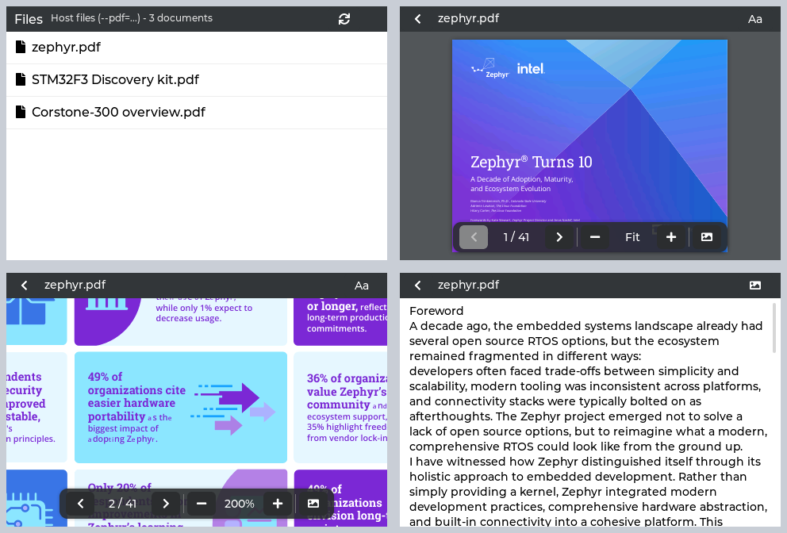

# zpdf

<p align="center">
  
</p>

A PDF reader for devices running [Zephyr RTOS](https://zephyrproject.org),
with the PDF parser and renderer packaged as a Zephyr module.

<p align="center">
  
</p>
<p align="center"><em>The document list, a page fitted to the view, a page at 200 % and the text view, on native_sim at the 480x320 of the target display.</em></p>

- Renders pages into RGB bitmaps at any scale: anti-aliased vector graphics,
  embedded TrueType, CFF and Type 3 fonts, built-in fallbacks for the
  standard 14 fonts, images including baseline JPEG, shadings, patterns,
  transparency and annotation appearances.
- Extracts the text of a page as UTF-8 for a fast, reflowed text view.
- Reads documents from an SD card and shows them with an LVGL touch
  interface: page navigation, zoom from fit-page to 300 %, panning in
  tiles, and a text mode.
- Runs on the ESP32-S3 (VIEWE UEDX32480035E-WB-A) and on `native_sim`.
- The library (`lib/zpdf`) is portable C with no dependency beyond libc,
  has a plain C API, and also builds on a host for tests and tools.

Full documentation: <https://walidbadar.github.io/zpdf/>

## Requirements

- Zephyr 4.5 (the manifest tracks `main`) and the Zephyr SDK.
- The `lvgl`, `fatfs` and `hal_espressif` modules, which the manifest pulls
  in; for the ESP32-S3 also `west blobs fetch hal_espressif`.
- For `native_sim`, the SDL2 development package.

## Getting started

The repository is a west manifest repository and a Zephyr module, laid out
like Zephyr's
[example-application](https://github.com/zephyrproject-rtos/example-application).
Either create a workspace from it:

```sh
west init -m https://github.com/walidbadar/zpdf --mr main zpdf-workspace
cd zpdf-workspace && west update
```

or build it inside an existing workspace as an extra module:

```sh
west build -b uedx32480035e_wb_a/esp32s3/procpu -d build/esp32s3 zpdf/app -- \
    -DZEPHYR_EXTRA_MODULES=$PWD/zpdf
```

If the workspace manifest does not list the `fatfs` module (the SD card
file system), add it to the list:
`-DZEPHYR_EXTRA_MODULES="$PWD/zpdf;$PWD/modules/fs/fatfs"`.

To use only the library from another project, add the repository to that
project's west manifest or pass `-DZEPHYR_EXTRA_MODULES=/path/to/zpdf` and
enable `CONFIG_ZPDF=y`.

## The reader

### ESP32-S3

The supported board is the VIEWE UEDX32480035E-WB-A (ESP32-S3, 8 MB PSRAM,
3.5" 480x320 touch display, SD card slot).

```sh
west build -b uedx32480035e_wb_a/esp32s3/procpu zpdf/app
west flash
```

### Using it

Put PDF files in the root directory of a FAT or exFAT formatted SD card.
The first screen lists them; tap one to open it. The reader follows the
layout of Acrobat: a title bar with the back arrow and the `Aa` toggle to
the text view, the page on a grey workspace, and a floating toolbar that
hides after three seconds (tap the page to bring it back).

| Control                          | Action                                        |
|----------------------------------|-----------------------------------------------|
| Back arrow                       | Close the document and return to the list     |
| `Aa` / page symbol               | Switch between the page view and the text view |
| Previous / page number / next    | Turn pages                                    |
| Zoom out / percentage / zoom in  | 50, 75, 100, 125, 150, 200 and 300 % of the page width (`CONFIG_ZPDF_APP_MAX_ZOOM_PCT` caps it) |
| Fit                              | Toggle between fit page and fit width         |
| Drag / tap on the page           | Pan / show or hide the toolbar                |
| BOOT button                      | Next page, in both views                      |

Drag to pan; the page is rendered in tiles of twice the visible area, so
panning inside the tile is instant and a new tile is rendered when you
leave it. In the text view the zoom buttons change the text size and a
swipe turns the page. Rendering and extraction run on a worker thread, so
the interface stays responsive while a page is prepared.
`CONFIG_ZPDF_APP_AUTO_OPEN` opens the first document at boot.

The whole file and all decoded data live in the 8 MB PSRAM
(`CONFIG_ESP_SPIRAM_HEAP_SIZE`); files larger than
`CONFIG_ZPDF_APP_MAX_FILE_SIZE` (6 MB by default) are refused. Rendering a
letter size page at 480 px wide takes 20 to 150 ms on a desktop; on the
ESP32-S3 at 240 MHz expect seconds, which is why the text view exists.

### native_sim (SDL window, mouse as touch)

```sh
west build -b native_sim/native/64 -d build/native zpdf/app -- -DZEPHYR_EXTRA_MODULES=$PWD/zpdf
./build/native/zephyr/zephyr.exe --pdf=/path/to/one.pdf --pdf=/path/to/two.pdf
```

Options of the simulator build: `--pdf=<path>` (repeatable) lists host
files, `--open` opens the first one right away, `--shot=<file.ppm>` writes a
screenshot after `--shot-delay=<ms>`, and `--page=<n>`, `--fit`,
`--zoom=<pct>` and `--text` choose what is shown in it.

## The library

Enable `CONFIG_ZPDF=y`.

```c
#include <zpdf/pdf_doc.h>
#include <zpdf/pdf_text.h>
#include <zpdf/pdf_render.h>

struct pdf_doc *doc = pdf_open(buf, len, err, sizeof(err)); /* buf stays owned by the caller */
size_t n = pdf_page_count(doc);
char *text;
if (pdf_page_text(doc, 0, &text) == 0) {
	/* UTF-8 text of the first page */
	pdf_text_free(text);
}
float w, h;
struct pdf_bitmap bm;
pdf_page_size(doc, 0, &w, &h);                       /* points */
if (pdf_render_page(doc, 0, 480.0f / w, &bm) == 0) { /* 480 px wide, RGB888 */
	pdf_bitmap_free(&bm);
}
pdf_close(doc);
```

The library allocates from `pdf_malloc()`, which is the external PSRAM
heap on Espressif SoCs with `CONFIG_ESP_SPIRAM`. A rendered region needs
3 bytes per pixel plus one byte per pixel for each active clip or soft
mask.

| Kconfig                    | Purpose                                              |
|----------------------------|------------------------------------------------------|
| `ZPDF_MAX_PAGES`           | Maximum number of pages collected from the page tree |
| `ZPDF_AUX_CACHE_BYTES`     | Decoded font programs kept between pages             |
| `ZPDF_IMAGE_MEM_BYTES`     | Budget for decoding one image; larger ones are decoded at a reduced size |
| `ZPDF_GLYPH_CACHE_BYTES`   | Rasterized glyphs during one page render             |
| `ZPDF_LOG_LEVEL`           | Log level of the library                             |

What the parser, the renderer and the text extraction handle, and what
they do not, is listed in the
[library documentation](https://walidbadar.github.io/zpdf/library.html).
Not handled: encrypted documents, predefined CJK CMaps, progressive JPEG,
JPX/CCITT/JBIG2 images (placeholder), mesh shadings, knockout/isolated
groups and text clipping modes.

Lower level access (`pdf_page()`, `pdf_get()`, `pdf_resolve()`,
`pdf_stream_decode()`) is available for other uses of the object model.

## Tests and host tools

```sh
west twister -p native_sim/native/64 -T zpdf/tests

make -C zpdf/tools/pdftext
zpdf/tools/pdftext/pdftext file.pdf 3             # text of page 3 (--dump, --fonts, --xobjects, --obj)
make -C zpdf/tools/pdfrender
zpdf/tools/pdfrender/pdfrender file.pdf 3 page3.ppm 480   # render page 3, 480 px wide
```

## Licence

GPL-3.0-only. The built-in fallback fonts are subsets of the Liberation
fonts (SIL Open Font License) and DejaVu Sans (Bitstream Vera licence), see
`lib/zpdf/fonts/LICENSE.*`. The Zephyr patch in `patches/` is contributed
under Zephyr's Apache-2.0 licence.

Zephyr is a trademark of The Linux Foundation; this project is not
affiliated with or endorsed by the Zephyr Project.
