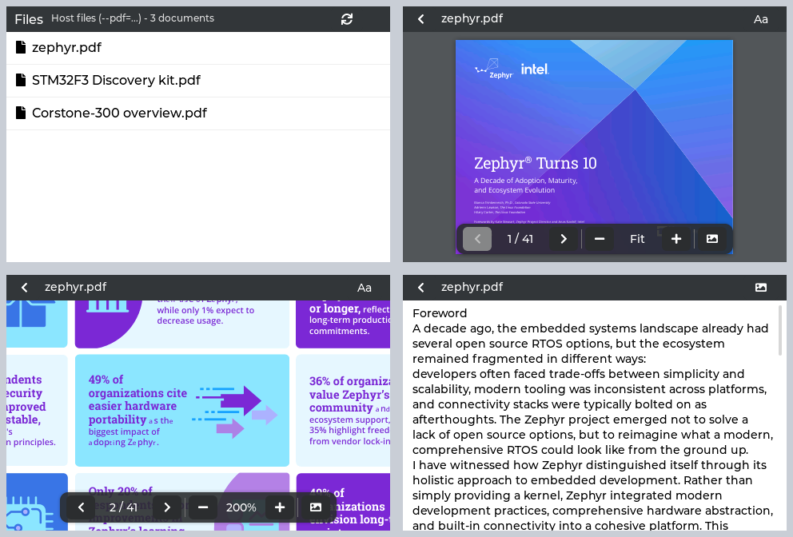

..
   Copyright (c) 2026 Muhammad Waleed Badar
   SPDX-License-Identifier: GPL-3.0-only

zpdf
####

A PDF reader for devices running `Zephyr RTOS <https://zephyrproject.org>`_,
with the PDF parser and renderer packaged as a Zephyr module.

         view, a page at 200 % and the text view
   :width: 840
   :align: center

   The document list, a page fitted to the view, a page at 200 % and the
   text view, on ``native_sim`` at the 480x320 of the target display.

Features
********

- Renders pages into RGB bitmaps at any scale: anti-aliased vector
  graphics, embedded TrueType, CFF and Type 3 fonts, built-in fallbacks for
  the standard 14 fonts, images including baseline JPEG, shadings, patterns,
  transparency and annotation appearances.
- Extracts the text of a page as UTF-8 for a fast, reflowed text view.
- Reads documents from an SD card and shows them with an LVGL touch
  interface: page navigation, zoom from fit-page to 300 %, panning in tiles,
  and a text mode.
- Runs on the ESP32-S3 (VIEWE UEDX32480035E-WB-A) and on ``native_sim``.
- The library (``lib/zpdf``) is portable C with no dependency beyond libc,
  has a plain C API, and also builds on a host for tests and tools.

.. toctree::
   :maxdepth: 2
   :caption: Contents

   getting_started
   reader
   hardware
   library
   architecture
   troubleshooting
   licence
