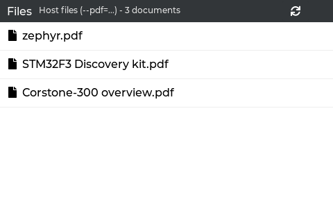
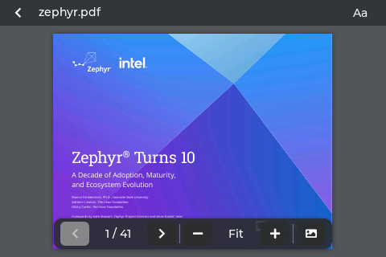
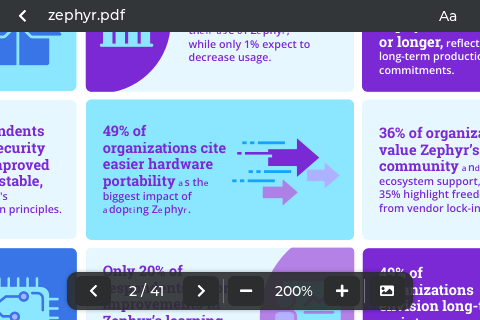
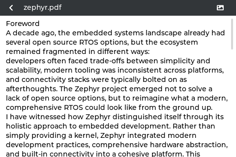

..
   Copyright (c) 2026 Muhammad Waleed Badar
   SPDX-License-Identifier: GPL-3.0-only

The reader
##########

The application in ``app/`` turns a board with a touch display and an SD
card into a PDF reader.

ESP32-S3
********

The supported board is the VIEWE UEDX32480035E-WB-A (ESP32-S3, 8 MB PSRAM,
3.5" 480x320 touch display, SD card slot); see :doc:`hardware`.

.. code-block:: sh

   west build -b uedx32480035e_wb_a/esp32s3/procpu zpdf/app
   west flash

Using it
********

Put PDF files in the root directory of a FAT or exFAT formatted SD card.
The first screen lists them; tap one to open it.

   The document list.

The reader follows the layout of Acrobat: a title bar with the back arrow
and the ``Aa`` toggle to the text view, the page on a grey workspace, and a
floating toolbar that hides after three seconds (tap the page to bring it
back).

   A page fitted to the view, with the floating toolbar.

.. list-table::
   :header-rows: 1
   :widths: 30 70

   * - Control
     - Action
   * - Back arrow
     - Close the document and return to the list
   * - ``Aa`` / page symbol
     - Switch between the page view and the text view
   * - Previous / page number / next
     - Turn pages
   * - Zoom out / percentage / zoom in
     - Steps of 50, 75, 100, 125, 150, 200 and 300 % of the page width
       (``CONFIG_ZPDF_APP_MAX_ZOOM_PCT`` caps it)
   * - Fit
     - Toggle between fit page and fit width
   * - Drag on the page
     - Pan
   * - Tap on the page
     - Show or hide the toolbar
   * - BOOT button
     - Next page, in both views

The page is rendered in tiles of twice the visible area, so panning inside
the tile is instant and a new tile is rendered when you leave it.

   A page at 200 %, rendered in tiles.

In the text view the zoom buttons change the text size and a swipe turns the
page. Text extraction is much faster than rendering, so it is the mode to
read long documents in on the ESP32-S3.

   The text view: the text of the page, reflowed to the display.

Rendering and extraction run on a worker thread, so the interface stays
responsive while a page is prepared. ``CONFIG_ZPDF_APP_AUTO_OPEN`` opens
the first document at boot.

The whole file and all decoded data live in the 8 MB PSRAM
(``CONFIG_ESP_SPIRAM_HEAP_SIZE``); files larger than
``CONFIG_ZPDF_APP_MAX_FILE_SIZE`` (6 MB by default) are refused.

native_sim
**********

The display is an SDL window with the mouse as the touch screen. Documents
are files of the host, named on the command line:

.. code-block:: sh

   west build -b native_sim/native/64 -d build/native zpdf/app -- -DZEPHYR_EXTRA_MODULES=$PWD/zpdf
   ./build/native/zephyr/zephyr.exe --pdf=/path/to/one.pdf --pdf=/path/to/two.pdf

.. list-table::
   :header-rows: 1
   :widths: 30 70

   * - Option
     - Effect
   * - ``--pdf=<path>``
     - A document to list; repeatable
   * - ``--open``
     - Open the first document right away
   * - ``--shot=<file.ppm>``
     - Write a screenshot (binary PPM) after ``--shot-delay`` and keep
       running
   * - ``--shot-delay=<ms>``
     - Delay before the screenshot (1500 ms by default)
   * - ``--page=<n>``
     - Turn to this page of the opened document before the screenshot
   * - ``--fit``, ``--zoom=<pct>``, ``--text``
     - Fit the page, zoom to a percentage, or show the text view before
       the screenshot

The screenshots in this documentation were taken this way, for example:

.. code-block:: sh

   ./build/native/zephyr/zephyr.exe --pdf=report.pdf --open --page=2 --zoom=200 \
       --shot=zoom.ppm --shot-delay=5000

Application options
*******************

.. list-table::
   :header-rows: 1
   :widths: 40 60

   * - Kconfig
     - Purpose
   * - ``ZPDF_APP_MAX_FILE_SIZE``
     - Largest document that is opened (bytes)
   * - ``ZPDF_APP_MOUNT_POINT``, ``ZPDF_APP_DISK_NAME``
     - Where the documents are mounted from (``/SD:`` on disk ``SD``)
   * - ``ZPDF_APP_MAX_FILES``
     - Maximum number of documents listed
   * - ``ZPDF_APP_AUTO_OPEN``
     - Open the first document at boot
   * - ``ZPDF_APP_MAX_ZOOM_PCT``
     - Largest page zoom in percent of fit-to-width
   * - ``ZPDF_APP_RENDER_STACK_SIZE``, ``ZPDF_APP_RENDER_PRIORITY``
     - The render and extraction worker thread
   * - ``ZPDF_APP_SD_TUNING``, ``ZPDF_APP_SD_DRIVE_STRENGTH``,
       ``ZPDF_APP_SD_DIN_PHASE``
     - ESP32-S3 SD slot tuning (see :doc:`hardware`)

The full list is in ``app/Kconfig``.
